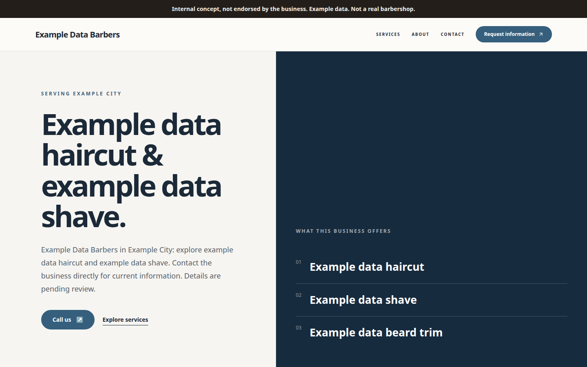
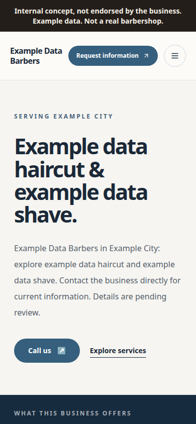
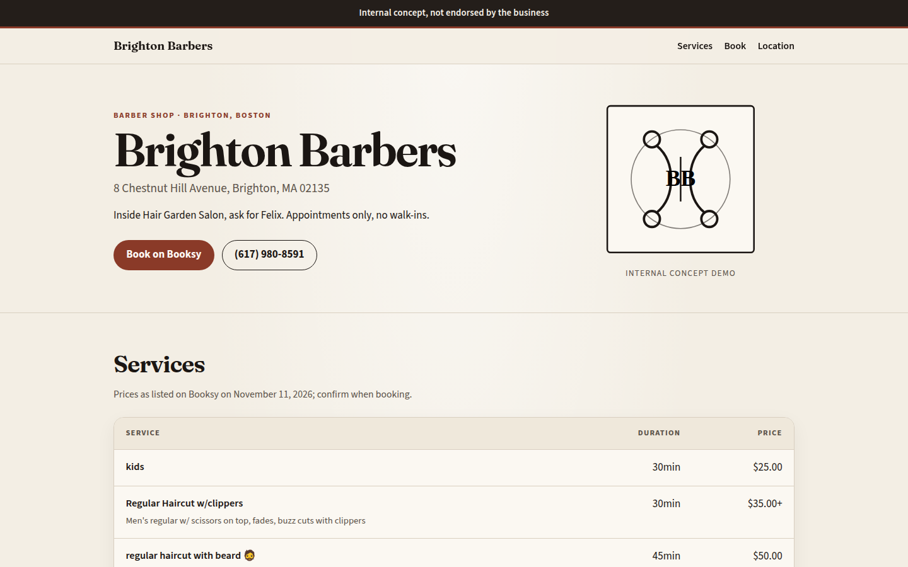
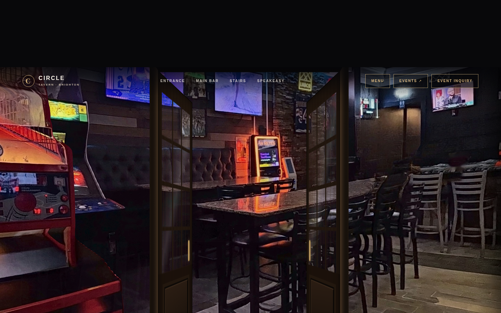

# Generator audit

The shipped page for a synthetic barbershop scores **63/100**. The Brighton Barbers internal demo scores **92/100** on the same rubric. The feedback-loop HTML for the same example scores **74/100**, and that HTML is not what export ships.

The blueprint preflight does not see this. The same example is scored **78** and rejected only because the facts are unreviewed. An in-memory simulation with `factStatus: 'researched'` is **accepted at 90**. Setting `owner_approved` in that simulation (not saved, not exported) is **accepted at 94**, with visual specificity still 20/20. The rendered page is the same either way.

## What was rendered

Business: **Example Data Barbers**, Example City. Every service, sentence, phone (`555-0100`), and email (`example-data@example.org`) is example data. It is not a real shop. `factStatus` stayed `unreviewed`. `owner_approved` was not set. `publishReady` is false. No client export was produced.

Command: `node --experimental-strip-types qa/generator/render-example.mjs`

That calls `createDraft` → `buildSiteBlueprint` and renders `SiteRenderer` with `standalone`, which is the prop the exporter passes. The audit harness adds the banner “Internal concept, not endorsed by the business” and `noindex`. The renderer does not.

| | Production `SiteRenderer` | Loop `renderPlanHtml` | Brighton demo | Circle public preview |
|---|---|---|---|---|
| Rubric | **63/100** | **74/100** | **92/100** | not scored (3D film, different document) |
| Template | `universal`, sector `other` | trait default `centered` / `classic-serif` / `orchard` | hand-built barber page | venue film |
| Type | system UI, no `@font-face` | names Literata and Inter Tight, loads neither | Fraunces + Source Sans 3, self-hosted woff2 | Impact / Avenir Next stack, gold on near-black |
| First screen | “Example data haircut & example data shave.” plus the same three names again in a navy panel | “Example data haircut and Example data shave in Example City” and the body “Example data.” | Name, street address, one booking fact, Booksy button, drawn monogram | Photograph of the room, gold wordmark, chapter card |
| Imagery | none (`getMatchedConceptSet` returned null) | none (`imageryDensity: none`) | SVG monogram, no shop photo (stated in the demo) | real room, depth, doors |
| Motion | `precision-reveal` / `indexed-rise` entrance fades | opacity transition | almost none | scroll-linked camera, chapters, film controls |

Screenshots:

- Production desktop: `qa/generator/output/example-data-barbers/screenshots/desktop-1440.png`
- Production 390px: `qa/generator/output/example-data-barbers/screenshots/mobile-390.png`
- Full pages: `desktop-1440-full.png`, `mobile-390-full.png` in the same folder
- Loop: `qa/generator/output/example-data-barbers-loop/screenshots/`
- Brighton: `qa/generator/output/brighton-reference/screenshots/`
- Circle, public preview `https://61c7713a.venu-e60.pages.dev/immersive/` (HTTP 200, title “Circle Tavern | 3D Venue Film · Private Review”). The saved frames are the main-bar chapter after the film had advanced, not a local build of `circle-venu`: `qa/generator/output/circle-preview/`









## Comparison

**Typography.** Brighton loads two families (Fraunces for the name and headings, Source Sans 3 for text) from `fonts.css` with `font-display: swap`. Circle uses a compressed display stack and a tracked small-caps UI in gold (`immersive/experience.css` on `feature/circle-hd-3d-motion-v2`). The production renderer computes `typeClass` as `font-serif` or `font-sans` and never applies it (`components/site-renderer.tsx:37`). The export layout loads no font files (`scripts/export-client-site.mjs:141-153`). The loop names Literata and Inter Tight (`lib/generator-loop/design-space.ts:48-54`, `lib/generator-loop/render.ts:26-27`) and emits no `@font-face`, so the browser falls back to Georgia.

**Layout variety.** Six composition names exist (`lib/demo-engine.ts:8`). This example hashed to `service-index`. The hero branch ignores that name (`components/site-industry-sections.tsx:251-265`). `centered`, `immersive`, `bento`, `serviceIndex`, and `heroGrid` are computed and unused (`components/site-renderer.tsx:29-38`). CSS only special-cases centered (text-align) and asymmetric (transform-origin) (`styles/site-motion.css:28-29`). The services are drawn twice: once in the hero panel, again under “What we do”. Brighton is one hero, a price table, a booking band, and a location grid. Circle is four full-viewport chapters (entrance, bar, stairs, speakeasy), not stacked cards.

**Imagery.** `getMatchedConceptSet` returns nothing for a barber because `barber` is in the hospitality exclusion (`lib/concept-imagery.ts:57-61`). The only assets are nine JPEGs for dental, landscaping, and a generic studio (`lib/concept-imagery.ts:13-28`), copied by the exporter (`scripts/export-client-site.mjs:26-30`). There is no monogram or other designed fallback. Brighton’s demo says photographs were left out on purpose and draws a mark instead. Circle is the room.

**Motion.** Production motion is a shared set of fades and `view()` cascades (`styles/site-motion.css:10-43`). Reduced motion is implemented (`styles/site-motion.css:53-55`). Circle’s motion is the camera: CSS perspective on the storefront, scroll-scrubbed chapters, letterbox, and a film transport (`immersive/experience.css`, `immersive/index.html`). The loop’s motion is one opacity transition (`lib/generator-loop/render.ts:40`) and that file says it never ships (`lib/generator-loop/render.ts:1-4`).

**Section structure.** The spec for this example is `hero, services, about, proof, contact` (`lib/demo-engine.ts:200-201`). `proof` is not a renderable key, so it is dropped (`lib/site-section-order.ts:4`, `lib/site-section-order.ts:13-14`). Leftover modules are then inserted before contact (`lib/site-section-order.ts:22-24`), which is why the page grows a “Discover / Discuss / Move forward” block the spec did not ask for (`components/site-industry-sections.tsx:127-140`). There is no price, duration, street address, or hours field on the production blueprint (`lib/site-blueprint.ts:34`). The loop facts model has address and hours and did emit a Visit section (`lib/generator-loop/compose.ts:163-164`). That section never reaches `SiteRenderer`. `integration.ts:81-83` lists hierarchy, palette, and motion system as unmapped.

**Copy.** The visible production lines are the template, not a barber:

- Eyebrow: `SERVING EXAMPLE CITY` (`lib/demo-engine.ts:237`)
- Headline: `Example data haircut & example data shave.` (`lib/business-specific-copy.ts:52-54`)
- Description: “explore example data haircut and example data shave. Contact the business directly for current information.” (`lib/business-specific-copy.ts:58-62`)
- Services heading: “Expertise organized around what comes next.” (`lib/site-blueprint.ts:198`)
- About heading: “A more useful introduction to the business.” (`lib/site-blueprint.ts:199`)
- Contact heading: “Talk directly with the team.” (`lib/site-blueprint.ts:200`)
- Journey: “Starting a conversation”, then Discover, Discuss, Move forward (`components/site-industry-sections.tsx:127-140` and `lib/site-presentation.ts:62-66`)

The header button says “Request information” (`lib/demo-engine.ts:241`, `components/site-renderer.tsx:69`). The hero button says “Call us” because a phone replaces `primaryAction` (`lib/site-presentation.ts:37-39`). Classification has no barber: the category falls through to sector `other` and the universal template (`lib/business-classification.ts:11-34`). Brighton’s hero is the shop name, the street, and one booking fact, with prices in a table and a source date on the price note. Circle’s lines are place lines (“No. 356”, “The main bar”) over the room. The loop hero body is the first sentence only (`lib/generator-loop/compose.ts:37`, `lib/generator-loop/compose.ts:121`); on this fixture that sentence is “Example data.”

**Responsiveness.** No horizontal overflow at 390px on the production page, the loop page, or Brighton (rubric: scroll width 390, client width 390). The production wordmark is capped at 150px, so “Example Data Barbers” breaks beside the pill (`components/site-renderer.tsx:66`). Brighton keeps the name on one line and stacks the monogram above the type. Circle hides the chapter nav under 760px and keeps Menu / Events (`immersive/experience.css` mobile block).

**Accessibility.** Production heading order passes (one h1, no skipped levels). Contrast on 44 text samples passed WCAG AA in Chrome. There is no skip link. Standalone mode prints `© 2026 Example Data Barbers` and does not print `internalDisclaimer` (`components/site-renderer.tsx:82`). That string is stored (`lib/site-blueprint.ts:219-220`) and has no other reader in the repo. The export layout sets no robots meta (`scripts/export-client-site.mjs:141-150`). Brighton and Circle both ship a skip link and the Circle page is `noindex`. The required internal-concept sentence on the example screenshots is the harness banner, not the generator.

**Performance.** Playwright’s transfer log for the Next response recorded **144237 bytes of JavaScript** and no font bytes. The rubric’s budget docks that (9/12). Brighton is 135042 bytes total, 0 JavaScript, perf 12/12. Lighthouse was not run. The number above is a transfer size, not a lab score.

## Ranked fixes

These are for the lanes that own `lib/` and `scripts/`. This lane did not edit them.

1. **Stop using the blueprint preflight as a visual grade.** `lib/site-evaluation.ts:48-55` gives visual specificity 10 points for a headline of 18+ characters and 5 points for any composition string. This example’s researched simulation is accepted at 90 with the page you see above. The export gate trusts `evaluation.accepted` (`scripts/export-client-site.mjs:49-52`). Point that gate at a rendered-page score (`qa/generator/score-site.mjs`) and keep the preflight as a facts check only.

2. **Apply the type and composition tokens, and load real fonts.** Delete or use the dead bindings at `components/site-renderer.tsx:29-38`. A composition name has to change the DOM, not only `data-composition`. Ship two woff2 families for the chosen pair. The loop renderer must `@font-face` the families in `lib/generator-loop/design-space.ts:48-54` or stop naming them (`lib/generator-loop/render.ts:26-27`). Map the five loop type systems without collapsing them (`lib/generator-loop/integration.ts:77-83`).

3. **Add a hospitality / beauty model, or stop sending those businesses through the consultancy copy.** `lib/business-classification.ts:11-34` has no barber. `lib/site-blueprint.ts:196-201` then writes “Expertise organized around what comes next.” Extend the blueprint past phone / email / city (`lib/site-blueprint.ts:34`) so a real street, hours, price, and duration can be shown, and so they stay absent when unknown. Brighton’s table is the shape. Do not invent prices to fill it.

4. **Stop refusing a visual identity for barbers, salons, and restaurants.** `lib/concept-imagery.ts:57-61` returns undefined for those words, and there is no monogram path. A page with zero images and zero mark is the current result. Match the trade or draw a mark. Do not reuse the dental JPEGs.

5. **One service list and one CTA label.** The hero panel repeats the services (`components/site-industry-sections.tsx:260-264`) and the services section repeats them (`components/site-industry-sections.tsx:81-91`). `lib/site-presentation.ts:37-39` renames the hero action to “Call us” while the header keeps `primaryAction` (`components/site-renderer.tsx:69`).

6. **Render the section order that was planned.** Dropping `proof` is documented (`lib/site-section-order.ts:13-14`). Reinserting `process` anyway (`lib/site-section-order.ts:22-24`) is why this page has a three-card journey the spec did not request. Either render proof from reviewed facts or do not put it in the order (`lib/demo-engine.ts:200-201`), and do not put the generic journey back.

7. **Put the internal-concept sentence on the page.** Render `internalDisclaimer`, and for anything that is not an owner-approved export use the exact text “Internal concept, not endorsed by the business” plus `noindex`. Standalone currently prints a copyright line (`components/site-renderer.tsx:82`). The export layout does not (`scripts/export-client-site.mjs:141-150`).

8. **Cut the client JavaScript, or budget it.** The exporter scaffolds a Next app (`scripts/export-client-site.mjs:154-158`) for a brochure. This run transferred 144237 bytes of JS. Brighton transfers none. A static HTML/CSS export clears the rubric’s 80000-byte JS line.

9. **Let the wordmark use the width it needs under 768px.** `components/site-renderer.tsx:66` sets `max-w-[150px]`.

10. **Do not fix only the loop.** It can show a visit block and it still scores 74, mostly because it is tiny. `lib/generator-loop/render.ts:1-4` is explicit that this HTML is not the customer page. `lib/generator-loop/integration.ts:81-83` is the list of decisions that die on the way to `SiteRenderer`.

## Measurable target

Re-run, from the repo root:

```bash
node --experimental-strip-types --disable-warning=MODULE_TYPELESS_PACKAGE_JSON --test qa/generator/score-lib.test.mjs
node qa/generator/score-site.mjs qa/generator/fixtures/brighton-barbers-demo
node --experimental-strip-types --disable-warning=MODULE_TYPELESS_PACKAGE_JSON qa/generator/render-example.mjs
node qa/generator/score-site.mjs qa/generator/output/example-data-barbers
node qa/generator/score-site.mjs qa/generator/output/example-data-barbers-loop
```

Recorded on 11 Nov 2026, Chrome, 390×844, reduced motion, scores in `qa/generator/output/scores.json`:

| Check | Max | Production | Loop | Brighton |
|---|---:|---:|---:|---:|
| heading-hierarchy | 12 | 12 | 12 | 12 |
| section-variety | 14 | 10 | 8 | 12 |
| image-alt | 10 | 4 | 4 | 4 |
| font-loading | 14 | 0 | 3 | 14 |
| boilerplate-copy | 10 | 0 | 7 | 10 |
| mobile-overflow | 14 | 14 | 14 | 14 |
| contrast | 14 | 14 | 14 | 14 |
| perf-budget | 12 | 9 | 12 | 12 |
| **Total** | **100** | **63** | **74** | **92** |

**Target for the production renderer: 92 or higher on this example**, still example data, still not `owner_approved`, with at least:

- font-loading 14 (two self-hosted families)
- boilerplate-copy 10 (none of the phrases in `qa/generator/score-lib.mjs`)
- section-variety 12 or higher
- perf-budget 12 (JS at or under 80000 bytes, no remote font stylesheet)

Image-alt is 4 on all three because none of them use ``. Brighton uses an SVG mark and says so. Raising that check with a dental JPEG or a generic studio photo is not the target. The imagery bar is a mark or a trade-matched, rights-labelled image, judged by looking at the screenshot.

Circle is not a number on this rubric. It is the reference for a page that is obviously one specific place. A barbershop does not need a WebGL film. It does need to be as specific as Brighton, and a venue page that claims to approach Circle needs photography or a filmed room, a display face, and motion tied to that room.

Checks the rubric does not award points for, and a rerun still has to pass by eye:

- The hero and the services section do not repeat the same list.
- Header and hero use one action label, and it is the trade’s action.
- `service-index` (and the other five names) change the layout.
- A barber is not described as a consultancy.
- The page itself contains “Internal concept, not endorsed by the business” and `noindex` when it is not an approved export.

## Limits

- Lighthouse was not run. Perf is the byte budget above.
- `next build` in the preview exits 1 after writing the page because Next.js 16.4.0 prints a security advisory. The render script continues when `index.html` is already on disk. The advisory is upstream of this lane.
- The Circle frames are the public preview after the film had reached the main bar. The entrance chapter was not the saved frame. Source comparison is from GitLab `andrew-makar-personal-projects-group/circle-venu`, branch `feature/circle-hd-3d-motion-v2`.
- The researched / owner-approved preflight numbers are an in-memory call to `evaluateSiteBlueprint`. Nothing was saved with `owner_approved`, and nothing was exported.
